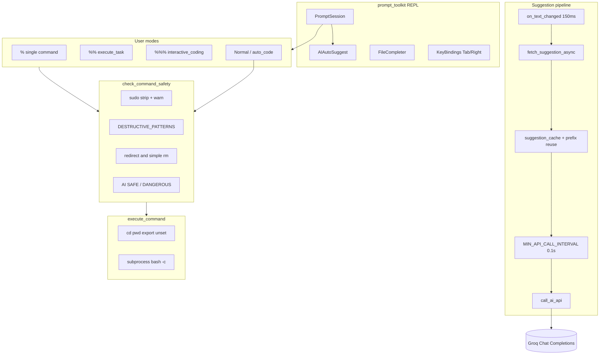

# Cliffy — AI-Enhanced Interactive Shell (Interview Guide)

Cliffy is a **Python REPL** that wraps terminal work with **LLM command completion**, **natural-language → shell**, **multi-step guided execution**, and **interactive code generation**, behind a **layered safety gate** before destructive commands run.

Use this file as an interview cheat sheet: what it does, how pieces talk to each other, why design choices were made, and how to defend tradeoffs.

---

## Table of contents

1. [Elevator pitch](#elevator-pitch)
2. [Problem & goals](#problem--goals)
3. [Features](#features)
4. [Repository layout](#repository-layout)
5. [Tech stack](#tech-stack)
6. [Setup & run](#setup--run)
7. [Architecture & data flow](#architecture--data-flow)
8. [How modules talk to each other](#how-modules-talk-to-each-other)
9. [Real-time auto-suggest pipeline](#real-time-auto-suggest-pipeline)
10. [Mode flows (`%` / `%%` / `%%%`)](#mode-flows----)
11. [Safety system](#safety-system)
12. [Command execution model](#command-execution-model)
13. [AI / Groq integration](#ai--groq-integration)
14. [Concurrency & performance](#concurrency--performance)
15. [Logging & status](#logging--status)
16. [Design decisions & tradeoffs](#design-decisions--tradeoffs)
17. [Limitations (honest answers)](#limitations-honest-answers)
18. [Extensions (good interview answers)](#extensions-good-interview-answers)
19. [Interview Q&A](#interview-qa)
20. [One-page mental model](#one-page-mental-model)
21. [Quick demo script](#quick-demo-script)

---

## Elevator pitch

> I built Cliffy, an AI shell assistant that sits in your terminal. As you type, it suggests complete shell commands via an LLM. Special prefixes let you describe a task in natural language and get an editable command, run multi-step workflows with explanations and confirmations, or generate project files interactively. Before anything dangerous runs, Cliffy uses fast substring pattern matching plus optional AI analysis. We deliberately do **not** whitelist “safe” base commands past chaining/`|`/`>` — because `ls && rm -rf /` starts with something safe.

---

## Problem & goals

| Problem | Cliffy’s approach |
|--------|-------------------|
| Shell is powerful but unforgiving (`rm -rf`, redirects, pipes) | Centralized **destructive pattern library** + confirmations + AI second opinion |
| Users forget exact flags / syntax | **Inline AI auto-suggest** while typing (ghost text) |
| Complex tasks need several commands | **`%%` mode**: split steps, explain, confirm each |
| Boilerplate from a one-liner idea | **`%%%` mode** + NL auto-code: filenames, multi-file plans, auto-save |
| `cd` / `export` don’t persist in a child process | Builtins via **`os.chdir` / `os.environ`** + optional **cwd sync file** for `source ./cliffy.sh` |

**Non-goals (current code):** not a full POSIX login shell; no sandbox / privilege drop; no full bash alias/`source` persistence; history file is touched but not wired into prompt_toolkit history.

---

## Features

| Capability | Trigger | Behavior |
|------------|---------|----------|
| Normal shell | Any command | Safety check → execute |
| Single AI command | `%` | Ask task → AI command → inline edit → safety → run |
| Multi-step task | `%%` | AI command(s) → split on `&&` / `;` → edit → explain → confirm → safety → run |
| Interactive coding | `%%%` or `%%% <task>` | Intent (dir?), filename(s), generate + auto-save (code not dumped to terminal) |
| Auto code (NL) | `create/build/write/make … python…`, `ai:`, `code:` | One-shot file gen with unique filename |
| Connection status | `status` | API health, model, masked key, optional retest |
| File completion | Tab (no active AI suggestion) | `FileCompleter` on path segment |
| Accept AI suggestion | Tab or Right arrow | Inserts ghost suggestion text |

---

## Repository layout

```
cliffy/
├── cliffy                   # Bash entry: exec python3 ai_shell_integration.py
├── cliffy.sh                # Source wrapper: child Python + parent cwd sync via CLIFFY_CWD_FILE
├── ai_shell_integration.py  # Main app (~1340 lines): REPL, AI, safety, execution
├── security_config.py       # DESTRUCTIVE_PATTERNS, AI_CHECK_TRIGGERS, SAFE_COMMANDS, SEVERITY_INFO
├── pattern_reference.py     # CLI: list patterns by severity
├── README.md                # This interview guide
└── env/                     # Local venv (optional; gitignored)
```

**Policy scale (live `security_config.py`):**

| Metric | Count |
|--------|-------|
| Destructive patterns | **86** |
| Severity split | critical 31 / high 30 / medium 23 / low 2 |
| Categories | **11** (file deletion, disk, overwrite, systemctl, perms, packages, git, DB, docker, network, malicious) |
| AI check triggers | **21** |
| Documented safe base commands | **49** (imported; **not** used as a bypass) |

---

## Tech stack

| Layer | Choice | Interview “why” |
|-------|--------|-----------------|
| Language | Python 3 | Fast iteration; `subprocess`, `threading`, `json` |
| TUI | **prompt_toolkit** | AutoSuggest ghost text, Completer, key bindings, styled prompt |
| HTTP | **requests** | Groq OpenAI-compatible chat completions |
| Config | **python-dotenv** (optional) | `GROQ_API_KEY` from `.env` |
| Shell glue | Bash | `exec` vs `source` for cwd persistence |
| LLM | **Groq** (`llama-3.1-8b-instant` default) | Low-latency suggests |

**Install (no `requirements.txt` in tree today):**

```bash
python -m venv env
source env/bin/activate
pip install prompt_toolkit requests python-dotenv
```

Versions used in the project venv (approx): `prompt_toolkit` 3.0.x, `requests` 2.32.x, `python-dotenv` 1.x.

---

## Setup & run

### Environment

| Variable | Default | Purpose |
|----------|---------|---------|
| `GROQ_API_KEY` | (required for AI) | Bearer token |
| `GROQ_API_ENDPOINT` | `https://api.groq.com/openai/v1` | API base |
| `GROQ_MODEL` | `llama-3.1-8b-instant` | Model id |
| `CLIFFY_CWD_FILE` | set by `cliffy.sh` | Path to write final cwd for parent shell |

### Home files

| Path | Purpose |
|------|---------|
| `~/.ai_shell_history` | Touched at startup (placeholder; not fully integrated as REPL history) |
| `~/.ai_shell.log` | Timestamped INFO / DEBUG / ERROR / WARNING |

### Two entry points (classic interview topic)

**1. `./cliffy` — Python *is* the session**

```bash
exec python3 "$SCRIPT_DIR/ai_shell_integration.py"
```

- `cd` persists **inside** Cliffy via `os.chdir`.
- Parent terminal cwd is unchanged when you exit.

**2. `source ./cliffy.sh` — child process + cwd handoff**

- Runs Python as a child.
- On exit, Python writes `os.getcwd()` to `$CLIFFY_CWD_FILE`.
- Wrapper `cd`s the **parent** shell there, then deletes the file.

**Interview line:** *A child process cannot change its parent shell’s cwd. Either `exec` Cliffy as the shell, or use a small handoff file after exit.*

---

## Architecture & data flow

### High-level layers

```
┌─────────────────────────────────────────────────────────────┐
│  prompt_toolkit REPL                                        │
│  PromptSession · AIAutoSuggest · FileCompleter · KeyBindings│
└────────────────────────────┬────────────────────────────────┘
                             │ submit line / type events
         ┌───────────────────┼───────────────────┐
         ▼                   ▼                   ▼
  Suggestion pipeline   Mode router        Normal command
  (debounce → thread →  % / %% / %%% /     / auto_code NL
   cache → rate limit → status / exit
   Groq)
                             │
                             ▼
                  check_command_safety()
                  (patterns → redirect/rm → AI)
                             │
                             ▼
                     execute_command()
                  builtins (Python) | bash -c
```

### End-to-end: normal command

```
User types "ls -la"  →  (optional ghost suggest while typing)
  → Enter
  → clear current_suggestion
  → is_auto_code_request? no
  → check_command_safety("ls -la")
  → execute_command → subprocess.run(["bash", "-c", "ls -la"])
  → stdout/stderr to terminal
```

### End-to-end: typing suggest (async)

```
on_text_changed (150ms debounce)
  → daemon thread: fetch_suggestion_async(text, session)
  → get_ai_suggestion
        → cache hit? return
        → else rate-limit (0.1s) → call_ai_api → clean → cache
  → current_suggestion = result  (under suggestion_lock)
  → session.app.invalidate()
  → AIAutoSuggest.get_suggestion() paints gray suffix
  → Tab / Right accepts
```

### Mermaid (same story)



---

## How modules talk to each other

| From | To | How / what crosses the boundary |
|------|-----|----------------------------------|
| `cliffy` / `cliffy.sh` | `ai_shell_integration.main()` | Process start; optional `CLIFFY_CWD_FILE` env |
| `PromptSession` | `AIAutoSuggest` | Reads global `current_suggestion` under lock; returns `Suggestion` suffix |
| `on_text_changed` | `fetch_suggestion_async` | Spawns **daemon thread** with buffer text + session |
| Suggest thread | Groq | `call_ai_api` → POST `/chat/completions` |
| Suggest thread | UI | Writes `current_suggestion`, then `session.app.invalidate()` |
| Mode handlers (`%`/`%%`/`%%%`) | Groq | Feature-specific prompts via `call_ai_api` |
| All execute paths | `check_command_safety` | Raw command string in; `True`/`False` out |
| `check_command_safety` | `security_config` | Imports static dicts at import time |
| `check_command_safety` | Groq | Stage-2 only when triggers fire and `skip_ai` is false |
| Safe path | `execute_command` | Builtins mutate Python process; else `bash -c` |
| `main` exit | Parent shell | If `CLIFFY_CWD_FILE` set, write cwd string |
| Almost everywhere | `~/.ai_shell.log` | `log_message(level)` append |

**Separation of concerns:**

- **`ai_shell_integration.py`** = UX + orchestration + execution.
- **`security_config.py`** = policy data only (patterns, severity, triggers). Extending security should not require rewriting the REPL.
- **`pattern_reference.py`** = offline inspection of policy (`python3 pattern_reference.py critical`).

---

## Real-time auto-suggest pipeline

1. **Debounce 150ms** in `on_text_changed` (skip `?…` and `< 2` chars).
2. **Daemon thread** calls `fetch_suggestion_async`.
3. Skip if input “looks complete” (ends with space and ≥ 2 words).
4. **Cache:** exact key, else best shorter prefix whose cached suggestion still `startswith(current text)`.
5. **Rate limit:** global lock + sleep so API calls are ≥ **0.1s** apart.
6. Prompt: *“Complete this shell command (respond with only the completed command…)”*.
7. **Clean:** first line, strip comments/`"…"`, reject if suggestion doesn’t **start with** user text.
8. **Cache cap:** 100 entries; drop 20 oldest keys when full.
9. **Accept:** Tab (or Right) inserts `buff.suggestion.text`; Tab without suggestion starts file completion.

**Why this design:** keep the UI thread free, cut duplicate API calls while typing `git st` → `git sta` → `git stat`, and fail closed to empty suggestion on bad/slow responses.

---

## Mode flows (`%` / `%%` / `%%%`)

### `%` — one command, human edit, then run

```
% → "What command do you need?"
  → call_ai_api(generate specific shell command…)
  → prompt_command_edit (inline default)
  → check_command_safety → execute_command
```

Exact input must be `%` (not `% find files` on the same line).

### `%%` — multi-step task (`execute_task`)

```
%% → task text
  → call_ai_api(single bash command; prefer mkdir/touch; avoid sudo/rm unless asked)
  → strip markdown fences
  → split_command_steps (quote-aware split on && and ;)
  → for each step:
        edit inline → AI one-sentence explanation
        → sudo warning if needed → "Execute this step? [y/N]"
        → check_command_safety → cyan echo → execute_command
```

**Why split + per-step confirm:** one LLM reply may be `mkdir -p x && touch x/a x/b`; user should understand and veto each piece.

### `%%%` — interactive coding (`interactive_coding`)

```
%%% [optional task]
  → ai_parse_task_intent → JSON {needs_dir, dir_name} (fallback regex / prompts)
  → optional os.makedirs
  → AI filename → editable default
  → get_file_plan → list of filenames
  → single file: generate once, extract_code_block, write
  → multi-file: per-file confirm, generate, write (batch pause after 6)
```

**UX rule:** don’t dump code to the terminal — only “Auto-saved to …”.

### Auto-code without `%%%`

`is_auto_code_request`: `ai:` / `code:` prefixes, or starters `create|build|write|make` + python-ish phrasing → `auto_code_task` (unique filename, one-shot write).

---

## Safety system

### Philosophy (say this in interviews)

1. **LLM output is untrusted** — show/edit/confirm; never auto-run AI text blindly.
2. **Fast deterministic path first** — substring patterns, no network.
3. **Never trust “safe base command” when chaining/pipes exist** — comments in code document that `SAFE_COMMANDS` must not bypass checks (today the whitelist is imported but unused; all commands still go through pattern/redirect/AI logic).
4. **Don’t double-prompt** — if the user already confirmed a pattern / overwrite / simple `rm`, skip AI stage (`skip_ai`).

### Pipeline inside `check_command_safety`

```
cmd
  → if sudo: strip for analysis, warn elevated privileges
  → detect chaining (; && ||) and pipes (informational / skip-AI logic)
  → STAGE 1: for pattern in DESTRUCTIVE_PATTERNS: if pattern in cmd
        → severity emoji + description
        → for rm: find/wc file counts when possible
        → confirm y/n → return False or True (early return after confirm)
  → STAGE 1b: lone ">" (not ">>") to existing file or dangerous /dev/* → confirm
  → STAGE 1c: simple "rm …" with existing file targets → confirm
  → STAGE 2: if any AI_CHECK_TRIGGERS substring and not skip_ai
        → "Respond ONLY with: SAFE or DANGEROUS: <reason>"
        → if DANGEROUS → confirm again
  → return True
```

### Severity UX

| Level | Emoji | Meaning |
|-------|-------|---------|
| critical | 🔴 | System-threatening / total data loss |
| high | 🟠 | Significant loss / disruption |
| medium | 🟡 | Needs attention |
| low | 🟢 | Generally milder |

Inspect offline:

```bash
python3 pattern_reference.py
python3 pattern_reference.py critical
```

### Matching limitation (honest)

Matching is **`pattern in command`** (substring), not a full shell AST. That means:

- **False positives** possible (harmless text containing a dangerous substring).
- **False negatives** possible (obfuscation, unusual spacing, encoding).
- AI stage helps edge cases but is **non-deterministic** (`"DANGEROUS" in response.upper()`).

Production hardening story: argv-aware parser, allowlists, or OS sandbox (firejail/Docker/seccomp).

---

## Command execution model

### Handled in the Python process (state must live in Cliffy’s session)

| Command | Behavior |
|---------|----------|
| `cd` | `os.chdir`, `~` expansion, clear errors |
| `pwd` | `print(os.getcwd())` |
| `export VAR=val` | `os.environ[…] = …` |
| `unset` | delete from `os.environ` |
| `alias` | note: session/demo only; may still call bash |
| `source` / `.` | warning: only affects subprocess env |

### Everything else

```python
subprocess.run(["bash", "-c", cmd], check=False)
```

**Why `bash -c`:** brace expansion (`file{1..10}.txt`), pipes, redirects — same grammar users expect. **Cost:** same privileges as the user; no containment.

Non-zero exit codes are printed; exceptions are caught and shown.

---

## AI / Groq integration

### API shape

- `POST {GROQ_API_ENDPOINT}/chat/completions`
- Headers: `Authorization: Bearer {GROQ_API_KEY}`
- Body: `model`, `messages` (system + user), `max_tokens` (10 for health check, 150 for normal)
- Timeout: **10s**

### Prompt strategies by feature

| Feature | Intent |
|---------|--------|
| Auto-suggest | Complete command only |
| `%` | Specific shell command only |
| `%%` | One bash command; mkdir/touch examples; avoid sudo/rm unless asked |
| Safety | `SAFE` or `DANGEROUS: <reason>` only |
| `%%%` | Code only / filename / JSON intent / file list |
| Step explanation | One short sentence, no markdown |

### Failure handling

- Missing key → log error, empty string from `call_ai_api`
- HTTP / network errors → mark `api_connection_status["connected"] = False`
- Startup `test_api_connection()`; modes warn if disconnected but still attempt
- `status` shows masked key (`sk….last4`), endpoint, model, optional retest

---

## Concurrency & performance

| Mechanism | Detail |
|-----------|--------|
| Daemon threads | Suggest fetch never blocks the prompt loop |
| Locks | `suggestion_lock`, `cache_lock`, `api_call_lock` |
| Debounce | 150ms typing gate |
| API spacing | 0.1s minimum |
| Cache | O(1) exact + prefix reuse; max 100 |
| `complete_in_thread=True` | File completion off UI thread |

**Tradeoffs to mention:**

- Fast typing can race a slower API reply (submit clears ghost; stale thread may still update cache).
- No cancellation token for in-flight suggest requests.
- `SuggestionThread` / `suggest_command_threaded` exist but **main `%` path calls `call_ai_api` directly** (legacy helper).

---

## Logging & status

- `log_message` → append `~/.ai_shell.log` with timestamp + level.
- Logged: connection tests, API failures, safety AI sends, mode requests, cwd-file failures, debug suggest traffic.
- `status` command = live connection dashboard (not a log tail).

Privacy note: API key is masked in UI; prefer not logging full secrets (current logs focus on errors/status/requests).

---

## Design decisions & tradeoffs

| Decision | Benefit | Cost |
|----------|---------|------|
| Python REPL vs bash/zsh plugin | Full control of AI + safety UX | Not a real login shell; some builtins incomplete |
| Groq small/fast model | Low latency for ghost suggest | May hallucinate flags |
| Substring destructive patterns | Fast, easy to extend in `security_config.py` | FP/FN vs real parser |
| Confirm-before-run | User agency; safer demos | Friction for power users |
| `bash -c` for most commands | Correct shell grammar | No sandbox |
| Central `security_config.py` | Policy separate from REPL | Static import-time config |
| prompt_toolkit vs readline | Rich suggest + styling | Extra dependency |
| Two entry points (`exec` vs cwd file) | Solve parent-cwd problem two ways | Users must pick the right launcher |
| Skip AI after pattern confirm | Avoid double prompts | Relies on pattern coverage |

---

## Limitations (honest answers)

- No `requirements.txt` checked in (deps documented above).
- `docs/` / `tests/` appear in `.gitignore`; interview docs lived under `docs/` locally but are not the runtime.
- History file touched but not fully integrated with prompt_toolkit history.
- `source` / `alias` persistence incomplete vs real bash.
- No execution sandbox.
- AI safety parsing is brittle string match on `DANGEROUS` / `SAFE`.
- Offline / no-key mode: empty suggestions + warnings.
- `SAFE_COMMANDS` / `can_use_whitelist` reflect design intent; whitelist is **not** currently a fast-path skip in code (safer default).
- Exact `%%` only (unlike `%%%`, which supports `%%% task` on one line).

---

## Extensions (good interview answers)

1. **Shell AST / argv parser** instead of substring patterns.
2. **Structured safety JSON** from the model (`allowed`, `risk`, `reason`) with schema validation.
3. **Cancel in-flight** suggests (request id / generation counter).
4. **Offline mode**: local model or curated template cache.
5. **Plugin / per-team policy files** overlaying `DESTRUCTIVE_PATTERNS`.
6. **Audit log** of confirmed destructive commands.
7. **zsh/bash bridge** that forwards lines to Cliffy as a sidecar.
8. **pytest** for `split_command_steps`, safety edge cases, mocked `requests`.
9. Wire `FileHistory` to `~/.ai_shell_history`.

---

## Interview Q&A

### What is Cliffy?

An AI-enhanced terminal REPL: suggests commands as you type, turns tasks into shell commands with human confirmation, generates code into files, and gates destructive ops with patterns + optional LLM analysis.

### Why Python instead of a bash plugin?

Structure for HTTP, threading, and a rich TUI (prompt_toolkit). Bash remains the **execution engine** via `bash -c` for most commands.

### How do pieces talk end-to-end?

UI events update shared suggestion state; submit routes to a mode; AI modes call Groq; every run path hits `check_command_safety` which reads `security_config`; only then `execute_command` mutates process state or spawns bash.

### How do you prevent `rm -rf /`?

Pattern `rm -rf /` (and variants) in stage 1 → critical warning + required `y`. Chaining is recognized so “starts with ls” never means “skip checks.”

### Why two safety stages?

Stage 1 is local and predictable. Stage 2 catches unusual compositions (`rm`/`mv`/`curl`/…) patterns might miss — but only when triggers match and we haven’t already confirmed.

### How does auto-suggest stay fast?

Debounce, 0.1s API spacing, in-memory cache with prefix reuse, skip when input looks complete, daemon threads so the prompt never waits on HTTP.

### How is `cd` handled?

In-process `os.chdir` when Cliffy is the session. With `cliffy.sh`, final cwd is written to a temp file and the sourcing shell `cd`s after exit.

### What LLM / API?

Groq OpenAI-compatible chat completions; model via `GROQ_MODEL` (default `llama-3.1-8b-instant`).

### Difference between `%` and `%%`?

`%` → one command, edit once, run. `%%` → may be chained, split into steps, explain + confirm each, then safety + run.

### Difference between `%%%` and NL auto-code?

`%%%` is interactive (dirs, multi-file, confirms). Auto-code is a heuristic one-shot save for “create a python script…” / `ai:` / `code:`.

### What was the hardest part?

Safety UX vs chaining: avoid double confirmation while still catching `echo ok && rm file`, and keeping policy in a separate module without turning the whitelist into a footgun.

### How would you harden this for production?

Parser-based policy, sandbox execution, structured model outputs, request cancellation, tests with mocked API, and real audit logging.

### Security of the API key?

Env / `.env`; `status` masks the key; don’t commit `.env` (gitignored).

---

## One-page mental model

```
User types → [optional AI ghost suggest] → submit
  → mode? (% / %% / %%% / status / normal / auto-code)
  → AI generates text (if needed) → user edits / confirms
  → check_command_safety (patterns → redirect/rm → AI)
  → execute_command (builtin in Python OR bash -c)
```

Cliffy = **guardrailed LLM shell copilot**: fast suggestions, explicit human gates, and a maintainable **security policy module** (`security_config.py`) you can extend without rewriting the REPL.

---

## Quick demo script

```bash
cd /path/to/cliffy
source env/bin/activate
export GROQ_API_KEY="..."
./cliffy
# Wait for "AI API connected"
# Type partially: git st  → ghost suggest → Right/Tab to accept
# %          → "list python files recursively"
# %%         → "create demo_project and three empty txt files inside"
# %%%        → "python flask hello world api"
# status
# echo hello cliffy
# exit
```

Parent-shell cwd sync:

```bash
source ./cliffy.sh
cd /tmp
exit   # parent shell should land in /tmp
```
